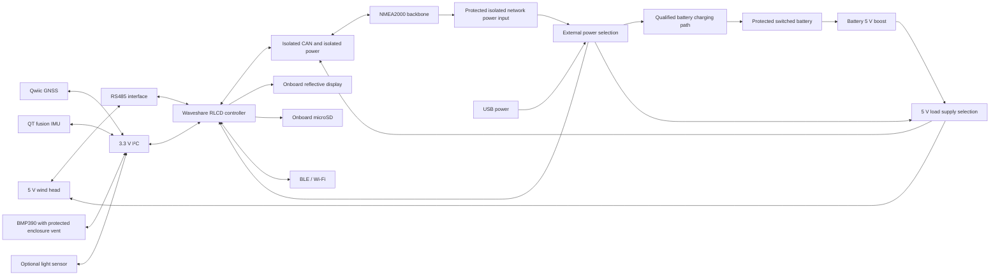

# Veetr Vane v2: hardware decisions

Design review: **2026-11-17**. This is the design overview and decision index for the next prototype. The [ESP32-S3-RLCD-4.2 integration specification](ESP32-S3-RLCD-4.2.md) is the source of truth for the v2 configuration, interfaces and pin allocation. It will become the final hardware specification after qualification; the present design is not production-approved.

## What v2 is intended to deliver

V2 keeps local wind, position, heading, heel and pitch measurements and BLE, while adding a readable standalone instrument, battery operation, SD logging and an isolated NMEA2000 interface with network-powered operation. Wi-Fi is available in the controller and needs its own integration and coexistence tests. Optional local sensors can be omitted when the boat's NMEA2000 network supplies equivalent data.

The architecture depends on moving GNSS from UART to I²C. That frees the two exposed UART pins for the ESP32-S3 CAN controller. Shared-bus testing therefore precedes carrier layout and NMEA2000 wiring. The existing RLCD proof of concept retains its working UART GNSS and wind connections until that gate passes.

The target supports operation and current-budgeted charging from a powered NMEA2000 cable, USB operation/charging, and battery fallback. The first carrier must accommodate the isolated network-power input and source selection, even if the network-power module is initially unpopulated. Battery access, source-selection circuitry and converter sizing remain design gates; see the [power decision](hardware/v2/POWER.md#nmea2000-power-and-first-carrier-provision).

## V1 baseline and lessons

The [v1 component record](COMPONENTS.md), [firmware pin definitions](../firmware/include/board/pins_esp32dev.h) and [sensor diagnosis](FIRMWARE_SENSOR_DIAGNOSIS.md) are the baseline. Marketplace product families do not identify a traceable manufacturing SKU; retain photos and markings of the actual reference unit before comparison tests.

| Function | V1 reference | RLCD proof of concept / lesson | V2 decision |
| --- | --- | --- | --- |
| Controller and display | DevKitC-style ESP32-WROOM-32U; external antenna; phone dashboard | RLCD adds a local display, SD socket and battery circuit; exposed pins are scarce | Retain RLCD; compare enclosed BLE range against v1's external antenna |
| GNSS | Realpoy NEO-8M UART breakout; seller/variant identified, exact silicon/firmware unverified | UART works but occupies the intended CAN pins | Compare MAX-M10S Qwiic with LC76G; qualify I²C before changing wiring |
| Heading / heel / pitch | BNO080-family fused IMU; exact board SKU unrecorded | Shared I²C exists; software scheduling can create stale data | Preserve fusion; test Adafruit BNO085 and the existing board side by side |
| Wind | Ultrasonic Modbus RS485 head and generic TTL converter | Head requires 5 V; current RLCD PoC wind works on USB, not battery alone | Keep wind protocol and pins; add qualified battery-to-5 V conversion |
| Radio | Working BLE data path | Display, logging and Wi-Fi increase workload | Preserve BLE; qualify simultaneous radio use and per-sensor freshness |
| Power | USB 5 V; roughly 200 mA normal / 400 mA peak documented as whole-device estimates | P1 VBUS is USB-powered; battery support does not supply external 5 V automatically | Measure every rail and startup load; do not size the boost from v1 estimates |
| Mechanical assembly | Custom carrier with headers and board-specific enclosure | Every board still needs retention, irrespective of connector | Use short Qwiic/QT cables for prototype; compare sockets before final carrier freeze |
| Data reliability | Independent wind/GNSS/IMU data sources | Diagnosis identified one-second telemetry gating and blocking Modbus paths | Log age and validity per source; distinguish firmware stalls from sensor faults |

The diagnosis provides software evidence, not measured proof that a particular replacement sensor is better. GNSS course over ground also does not replace magnetic heading at rest.

## Decision index

“Selected” means the architecture is retained. “Preferred prototype” means the part wins the current paper comparison but still has an acceptance gate. “Challenger” means buy only for a deliberate comparison. “Deferred” means there is no complete integration design yet.

| Decision | Current winner / status | Why it leads | Alternatives and decision record |
| --- | --- | --- | --- |
| Controller, display, SD | Waveshare ESP32-S3-RLCD-4.2 — selected platform | Existing PoC; integrated display, SD, battery circuit and radio | [Controller and storage](hardware/v2/CONTROLLER.md): v1 DevKitC; separate display / larger-I/O controller |
| GNSS | SparkFun GPS-18037 MAX-M10S — preferred prototype | Native Qwiic, documented I²C protocol and breakout, module-level conformity evidence | [GNSS](hardware/v2/GNSS.md): LC76G low-cost challenger, v1 UART, MikroE GNSS MAX |
| IMU | Adafruit 4754 BNO085 — preferred prototype, bus gate | Same fusion family, fitted QT ports, lower cost than Click | [IMU](hardware/v2/IMU.md): existing BNO080 and Smart DOF 4 Click; ESP32-S3 I²C caveat |
| NMEA2000 | Olimex A20-CAN-ISO — preferred prototype | EU-made/store, isolated power, open termination, signed board DoC, price | [Marine interfaces](hardware/v2/INTERFACES.md): three CAN Click variants and TI EVM |
| Wind interface | Existing converter — reference unit only | Preserves known working behavior during power and bus tests | [Marine interfaces](hardware/v2/INTERFACES.md): isolated RS485 candidates; production winner open |
| Network power | Isolated network-to-5 V input — selected requirement; module open | One NMEA cable carries data and power; preserves isolation and battery fallback | [Power](hardware/v2/POWER.md#nmea2000-power-and-first-carrier-provision): first carrier provision mandatory; fitting may be deferred |
| Battery-powered 5 V | Pololu 2562 U1V11F5 — first wind bench candidate | Small, low idle demand, true shutdown, published output curves | [Power](hardware/v2/POWER.md): Pololu 4085 higher-load challenger; power path and current gate |
| I²C assembly | Qwiic/STEMMA QT cables — prototype choice | Fitted connectors avoid module header soldering and per-board adapters | [Assembly and options](hardware/v2/ASSEMBLY_AND_OPTIONS.md): sockets, mikroBUS/ClickID |
| Night readability | Front-light experiment + Adafruit 4162 VEML7700 — optional prototype | Ambient sensing is inexpensive and connects directly to QT | [Assembly and options](hardware/v2/ASSEMBLY_AND_OPTIONS.md): optical design/driver still open |
| Barometer / enclosure vent | Adafruit 4816 BMP390 + BOPLA 52042000 — selected prototype candidates | Local pressure with a replaceable water barrier and recessed draining splash shield | [Assembly and options](hardware/v2/ASSEMBLY_AND_OPTIONS.md#barometer-and-protected-pressure-vent): vent alternatives, shielding and wet-response tests |

## Selection criteria

Safety and interface compatibility are gates; a low price cannot compensate for incompatible logic, inadequate power or an electrically unsuitable CAN drop. Among compatible candidates, prefer EU sourcing, clear evidence, repairable assembly and predictable supply. US sourcing is a useful fallback. No numerical score is assigned where missing data would create false precision.

| Criterion | Evidence used in the decision records |
| --- | --- |
| EU / US sourcing and quantity | Exact manufacturer SKU, regional seller, dated stock snapshot; a price tier is not inventory |
| Price | Currency, VAT basis, date and included accessories; compare landed assembled cost, not only board price |
| Quality and reliability | Schematics, traceable suppliers, documented limitations and tests; no unmeasured ranking of accuracy or marine ruggedness |
| Features and connection | Required measurements, interface protocol, connector population, auxiliary signals, solder/configuration work |
| Voltage and current | Board input versus IC rails; idle, operating and startup current; measured values distinguished from datasheet examples |
| Temperature | IC/module operating range versus complete-board rating; final battery/display/enclosure limits remain separate |
| Compliance | Exact scope of signed declarations and radio grants; [project evidence register](COMPLIANCE.md) |
| License | Hardware design files, host library and proprietary module firmware considered separately; open hardware is not a compliance certificate |
| Long-term supply | Revision history, manufacturer lifecycle status, alternate sources, PCN/EOL policy and written quantity quotes |

## New features and implementation boundaries

| Feature beyond v1 | Intended behavior | Prototype completion evidence |
| --- | --- | --- |
| Standalone display | Sailing values without a connected phone | Fresh, readable display while other interfaces are busy |
| NMEA2000 receive / transmit | Receive boat data; publish selected valid local measurements | Isolated electrical tests, address claim, supported PGNs and interoperability; [scope](hardware/v2/INTERFACES.md#nmea2000-feature-scope) |
| SD logging | Local timestamped measurements and diagnostics | Wind + SD concurrency, bounded write delays and recoverable power loss |
| NMEA2000 power | Run the complete instrument and charge within a defined network load budget; USB optional | Protected isolated conversion, no backfeed, charging/current limits and source switchover tested |
| Integrated battery | Local sensors and wind continue with USB removed | Correct cutoff, charging, switchover and measured endurance |
| Wi-Fi | Additional connectivity without degrading BLE or sensor acquisition | Feature selection and coexistence workload defined before release |
| Optional sensors | Use configured NMEA sources when local hardware is omitted | Explicit source selection, freshness timeout and honest unavailable states |
| Night lighting | Dimmable front illumination; Auto / Off / On | Wet-window glare, ambient feedback and battery tests |
| Pressure trend | Local BMP390 through protected enclosure vent; selectable NMEA source | Measure atmospheric response, wind-induced error and recovery after wetting/salt exposure; qualify complete enclosure |

## From design to the next prototype

Use the [prototype order and test plan](hardware/v2/PROTOTYPE_ORDER.md) for quantities, sourcing, assembly instructions and staged acceptance. Record each test unit's actual board revision, firmware commit, settings and results there before promoting a preferred part to the final specification.

The lower-cost-than-v1 objective remains unproven: v1 lacks a like-for-like invoiced BOM. Compare complete new-build v1 and v2 costs with the same wind head, antenna, battery, carrier, enclosure, labour, tax and shipping assumptions. Reused parts reduce prototype spending but do not reduce the production BOM.
