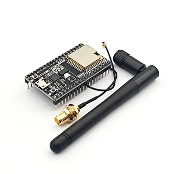
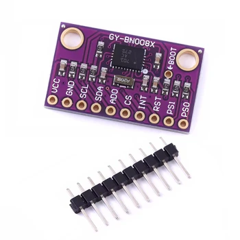
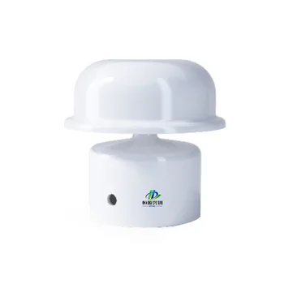
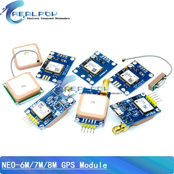
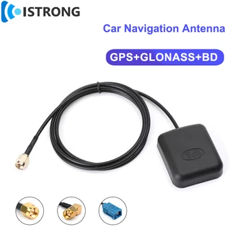
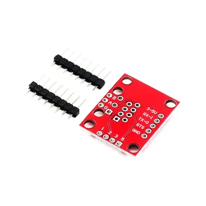

Tato stránka uvádí moduly současného prototypu. Před nákupem ověřte model, konektor a napětí: nabídky prodejců i revize desek se mohou bez upozornění změnit.

## Nákupní seznam

- ESP32 DevKitC s modulem ESP32-WROOM-32U a konektorem externí antény
- Modul devítiosé IMU BNO080 nebo BNO085
- Ultrazvukový snímač větru RS485
- GPS přijímač a externí GPS anténa
- Převodník RS485–TTL kompatibilní s logikou 3,3 V
- Nosná deska Veetr a vytištěná krabička
- Externí BLE anténa, kabel USB-C, konektory, pinové lišty a montážní materiál

## Hlavní řídicí jednotka

### ESP32 DevKitC WROOM-32U

| Vlastnost | Požadavek |
| --- | --- |
| Modul | ESP32-WROOM-32U |
| Anténa | Konektor externí antény 2,4 GHz |
| Logické napětí | 3,3 V |
| Napájení/programování | USB-C na vývojové desce |
| Použitá rozhraní | I²C, UART, GPIO a BLE |
| Tlačítka na desce | RESET/EN a BOOT |

Varianta `-32U` je důležitá kvůli externí anténě používané v krabičce. Před připojením modulu si přečtěte **[zapojení](/cs/docs/wiring/)**.

**Odkaz k nákupu:** [ESP32 DevKitC WROOM-32U](https://s.click.aliexpress.com/e/_c3ctWFj9)

## Snímač pohybu

### Devítiosá IMU BNO080/BNO085

| Vlastnost | Požadavek |
| --- | --- |
| Snímač | BNO080 nebo BNO085 s vestavěnou fúzí senzorů |
| Rozhraní | I²C |
| Logické napětí | 3,3 V |
| Měření Veetr | Směr, příčný a podélný náklon a pohyb |

Vyberte modul s vyvedenými `VCC`, `GND`, `SDA` a `SCL`, kompatibilní s logikou 3,3 V.

**Odkaz k nákupu:** [Modul BNO080/BNO085](https://s.click.aliexpress.com/e/_okDR7nd)

## Snímač větru

### Ultrazvukový snímač RS485

| Vlastnost | Požadavek prototypu |
| --- | --- |
| Měření | Rychlost a směr zdánlivého větru |
| Rozhraní | RS485 Modbus RTU |
| Výchozí přenosová rychlost | 9600 baud |
| Napájení | Ověřte štítek; současný prototyp používá model 5–12 V |
| Montáž | Volné proudění větru, obvykle na vrcholu stěžně nebo na palubě |

Snímač se připojuje na stranu RS485 převodníku, nikoli přímo na GPIO ESP32.

**Odkaz k nákupu:** [Ultrazvukový snímač RS485](https://s.click.aliexpress.com/e/_onkySgT)

## GPS

### Modul GPS přijímače

| Vlastnost | Požadavek prototypu |
| --- | --- |
| Přijímač | Modul rodiny NEO-8M |
| Rozhraní | UART |
| Napájení | Napětí podporované konkrétním modulem |
| Data | NMEA poloha, rychlost, kurz, čas a stav signálu |
| Anténa | Vestavěná plošná nebo kompatibilní externí anténa |

**Odkaz k nákupu:** [GPS přijímač](https://s.click.aliexpress.com/e/_onLOZmT)

### Externí GPS anténa

Konektor a požadavky aktivní antény musí odpovídat zakoupenému GPS modulu.

**Odkaz k nákupu:** [Externí GPS anténa](https://s.click.aliexpress.com/e/_oExx7iF)

## Převodník RS485

### Modul RS485–TTL

| Vlastnost | Požadavek |
| --- | --- |
| Funkce | Převod diferenciálního signálu RS485 ze snímače větru na UART logiku ESP32 |
| Logická strana | Kompatibilní se signály ESP32 3,3 V |
| Strana snímače | Diferenciální pár `A`/`B` |
| Řízení | Vyvedené povolení vysílače/přijímače `DE`/`RE` |

Označení modulů se liší. Před použitím **[tabulky zapojení](/cs/docs/wiring/)** ověřte názvy pinů na dodané desce.

**Odkaz k nákupu:** [Převodník RS485](https://www.aliexpress.com/item/32688467460.html)

## PCB a krabička

Nosná deska Veetr drží moduly a rozvádí napájení a signály. **[Návod k PCB a Gerber souborům](/cs/docs/pcb/)** obsahuje výrobní podklady, upravitelný návrh, popis souborů a kontrolní seznam objednávky.

Krabička je vytištěná a má otvory pro RJ45, BLE anténu, USB-C a GPS anténu. Nástěnná lišta umožňuje jednotku vyjmout a vrátit do stejné polohy. Imbusový klíč slouží jako čep pantu i nástroj k rozebrání. Před tiskem a montáží čtěte **[Krabička a upevnění](/cs/docs/enclosure/)**.

Původní stránka stavebnice uváděla také pinové lišty, zásuvku a zástrčky RJ45, stíněný datový kabel, šrouby M2.6, imbusové klíče, rezistor 330 Ω a zelenou stavovou LED. Odkazy a popisy zůstávají v **[úplném původním seznamu dílů](/cs/kit/#parts)**.

## Partnerské odkazy

Některé nákupní odkazy jsou partnerské. Nákupem přes ně malou částí podpoříte Veetr, aniž se změní vaše cena. Můžete také vyhledat přesný model a koupit jej jinde.
